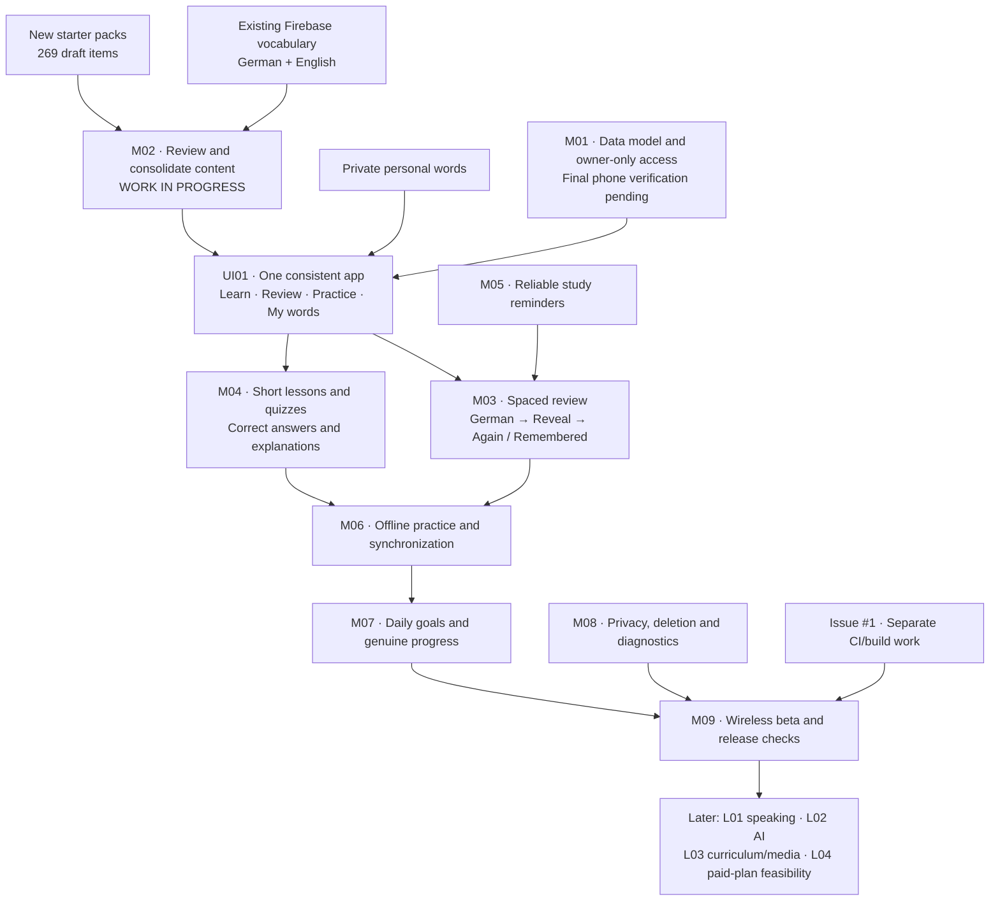

# German Reminder next milestone plan

Prepared 24 November 2026. Decision proposal for the next release after 1.0.1+14.

Build a dependable five-minute German vocabulary practice habit: open a reminder, recall a word, receive an explanation, and know when to review it again. Start with a reviewed A1 starter collection and personal vocabulary. A complete CEFR course, social network and unlimited AI conversation would exceed the useful scope of this release.

## Project evidence and scope

Inspected the actual workspace and its clean GitHub clone at `build/github-sync`, master commit `ee1f7d1d1743d2d0cb1beba6fc344ad348d7daf6`. No applicable AGENTS.md files were found. Production submission and 19 passing relevant tests are supplied release context; this planning task did not rerun the app or tests. No emulator was opened. No learning features or CI configuration are changed by this plan.

| Existing capability | Evidence | Gap affecting the milestone |
| --- | --- | --- |
| Firebase email account flow, verification, password reset, App Check | `lib/frontPage.dart`, `lib/signupPage.dart`, `lib/verifyEmailPage.dart`, `lib/main.dart`, `pubspec.yaml` | Preserve recent fixes; deployed rules and billing configuration still need an inventory. |
| Level collections and personal words | `lib/databaseFirebase.dart`, `lib/userCollectionDatabase.dart`, `lib/main.dart` | Generic documents hold `wordStorage` arrays; personal saves replace the user document with an array. There are no stable learning item IDs, per-item mastery or content versions. |
| Reminder controls and notification route | `lib/main.dart` timerStart, `lib/notification_api.dart`, `lib/secondPage.dart` | Home uses Dart Timer then showNotification; it is not durable after process death. Scheduling helper exists but the home flow does not use it. Notification page displays a word and Back, without recall practice. |
| German playback | `flutter_tts: 4.0.2`, collection screens | Device TTS already avoids an app-paid cloud speech bill; availability and downloaded voice quality vary. No listening exercises or speech assessment. |
| Vocabulary quiz | `lib/germanQuizData.dart`, `lib/germanBasicTest.dart`, `lib/resultPage.dart`, 55 entries in `assets/quiz_data.json` | Recognition questions have no IDs, explanations or history. Score thresholds assign A1 through C2 without a validated proficiency assessment. Completion calls showResult before CheckGermanLevel. |
| Local storage and profiles | Hive, shared_preferences, profile pages and layout tests | No explicit offline learning queue, cross-device learning conflict policy or account-scoped practice history. Account deletion calls Auth delete, without a visible linked Firestore cleanup flow. |
| Content and operational setup | Current assets, dependencies and repository file inventory | Example content needs German noun capitalization, umlauts and translation review. No local Firestore rules, Functions source, Analytics or Crashlytics setup was found. Absence locally does not establish the deployed service state. |

Current Generic collection contents and their licenses were not available from source control. Audit an authorized export before migrating them; do not assume the existing level labels mean reviewed CEFR coverage.

## Comparison with current language learning products

These are documented product capabilities, not independent evidence that matching a feature reproduces learning outcomes. Availability can depend on platform, course and subscription.

| Product | Current primary source evidence | Useful lesson for German Reminder |
| --- | --- | --- |
| Duolingo | A learning path and personalized Practice Hub organize new learning and practice. Spaced repetition revisits earlier material within lessons. [Practice guidance](https://blog.duolingo.com/whats-the-best-way-to-learn-with-duolingo/), [spaced repetition](https://blog.duolingo.com/spaced-repetition-for-learning/) | Make the next action obvious: due review first, then a small new set. Prioritize recall and feedback before points or leaderboards. |
| Babbel | Review uses spaced repetition for vocabulary retention. [Babbel review](https://support.babbel.com/hc/en-us/articles/360037496932-Memorizing-vocabulary) | Add an explicit due queue and productive recall alongside multiple choice. |
| Busuu | Study Plans support regular study habits; Vocabulary Review offers practice, with plan and platform restrictions. [Study Plan](https://help.busuu.com/hc/en-us/articles/16097312171153-What-s-a-Study-Plan-How-do-I-make-one), [Vocabulary Review](https://help.busuu.com/hc/en-gb/articles/16941990776593-How-can-I-review-my-vocabulary) | Offer a modest daily goal and progress view. Do not infer that every review mode is free or available on Android. |
| Memrise | German offering advertises native speaker video and AI speaking practice. [German offering](https://www.memrise.com/en/learn-german) | Contextual audio is useful; rights-cleared video and open conversation belong after retention and demand are measured. |

Positioning: a focused German reminder and recall companion for English-speaking beginners and learners maintaining personal vocabulary. Promise reviewed starter practice and a reliable habit, rather than fluency or CEFR certification. Existing advanced collections remain reference material until reviewed.

## Mandatory next features

### Consolidated learner journey — 25 November 2026

Existing Firebase vocabulary and English meanings are input to M02, not a
library to discard. Inventory the live document structure, retain German/English
pairs, review meaning and usage, deduplicate with stable IDs, then add approved
entries to the common versioned catalog. Keep the original data read-only until
mapping and counts reconcile. Bundled starter packs enable offline access;
future reviewed remote updates use the same content model. Personal words stay
private and separate from publisher-owned content.

The current centre flip card renders the same word on both sides and also picks
a random word when toggled. M03 replaces this behaviour with one stable item:
German prompt, explicit reveal of its English meaning/example, then Again or
Remembered to schedule the next review. M04 adds scored lessons and explanations.

The home HH/MM/SS reminder uses an in-process Dart Timer. M05 replaces it with
opt-in OS-scheduled study reminders, persisted settings, timezone/reboot handling,
cancellation and a review destination. The quiz countdown is a different feature:
M04 owns its safe timeout/results handling; optional timed practice is the proposed
design, while ordinary recall review should be untimed.

UI01 (#16) consolidates navigation, visual components and library/review/lesson
presentation. M06 synchronizes private practice, M07 shows actual goals and
progress, M08 supplies privacy/deletion and operational diagnostics, and M09
provides the wireless beta/release gate. CI issue #1 remains separately owned.
L01–L04 remain later experiments, not dependencies for the core learning loop.

Status after checking the published issues: M01 stays open because its recorded
physical-account/pagination/migration gates have not been demonstrated. M02 stays
in progress; neither draft generation nor the preview UI is editorial signoff.

P0 means a foundation or release blocker. P1 means required to complete this learning milestone. Dependencies below are planning IDs; the published ticket register resolves them to GitHub issue numbers. Estimates are engineering days including focused tests and review, excluding content editor time.

## M01 Learning data and access foundation

Priority: P0. Dependencies: none. Effort: 5 to 7 days.

Learner benefit: progress and personal words survive upgrades without leaking between accounts. Current gap: whole-document arrays cannot safely carry independent review state.

Implementation dependencies: keep cloud_firestore, firebase_auth and Hive; introduce repositories and versioned Dart models without an unrelated state management rewrite. Proposed content fields: stable ID, German lemma, article and plural where applicable, English meaning, example, topic, level tag, source, rights, editorial status and version. Proposed user state: item ID, dueAt UTC, interval, lapse count, last attempt and scheduler version. Use bounded user subcollections and local account namespaces. Copy legacy arrays to a versioned representation with checkpoints; keep originals until migration reconciliation passes.

Firebase fit: Auth for identity; Firestore for user-owned state and published content metadata; Security Rules for ownership, field and size limits; App Check complements identity. Deploy rules from version control after inspecting the live rules and existing clients. Backend admin publishing is needed only when remote publishing begins.

Acceptance criteria:
- Stable IDs and versioned schemas cover all new content and learning state.
- Migration is repeatable, interruption-safe, preserves all unique legacy personal words, and has a rollback and reconciliation report.
- Missing or malformed legacy documents render a recoverable state rather than a crash.
- Owner-only reads and writes, rejected cross-user access, and client read-only curated content are verified with automated rules checks; no emulator is launched in this chat. Select an allowed test strategy during implementation.
- Bounded queries and index requirements are documented; legacy saves cannot overwrite learning metadata.

## M02 Reviewed German starter content

Implementation started 2026-11-25. See [M02 progress and change checklist](m02-content-progress.md).
Current delivery: the owner explicitly accepted the content and requested offline
inclusion. Catalog v4 publishes 269 structured words; quiz catalog publishes all
55 corrected questions. Another 1,059 legacy entries are bundled with complete
source reconciliation. Home and the shared browser now load local assets.
Owner approval replaces the originally planned independent-review gate for this
delivery; no independent German review or CEFR certification is claimed. The
user accepted the phone build and reported uploading M02 to Play; publication
is not independently verified. GitHub #4 was closed as completed on 2026-11-26.
The learning library supports A1–C2 with the same level/topic filtering and word
details. The first 150 A1 items are a starter pack, not complete A1 coverage;
additional reviewed packs can expand A1 and populate other levels independently.
Draft and legacy content must not silently appear as reviewed library content.

Priority: P0. Dependencies: M01 schema. Effort: 5 to 7 engineering days plus 8 to 12 editor days.

Learner benefit: learners memorize correct, useful German with context. Current gap: bare strings and quiz entries lack sufficient linguistic metadata and provenance.

Implementation dependencies: a native or qualified German reviewer, original or explicitly licensed material, a JSON validation tool and bundled versioned assets. Deliver 150 unique A1-oriented items in 10 practical topics, each with an English meaning and German example plus translation; noun article/plural and relevant usage notes are mandatory. Audit all 55 existing quiz entries, correct or withdraw them, and tag retained questions to stable item IDs. A1-oriented denotes topic selection, not complete A1 coverage.

Firebase fit: no additional service is required for bundled content. Firestore can later hold a publication manifest; Storage can serve downloadable packs after rights and billing are checked.

Acceptance criteria:
- All 150 items and retained questions have editorial signoff, provenance, usage rights and content version.
- Validation rejects duplicate IDs, missing required fields and invalid answer indices; every answer has an explanation.
- German capitalization, umlauts, articles and translations pass editorial review, including existing examples such as accommodation and inexpensive.
- Existing remote collections are inventoried and retained or quarantined explicitly; no unreviewed item silently enters the starter deck.
- No copied competitor exercises or scraped dictionary corpus is shipped.

## M03 Spaced review scheduler and recall session

Implementation started 2026-11-25. See [M03 implementation and phone checks](m03-review-progress.md).
Completed 2026-11-26: all feature criteria/core phone checks passed, 63 tests
passed and targeted analysis was clean. Signed 1.0.4+17 release bundle/notes are
verified and ready for the owner's production upload. GitHub #5 is closed;
Google publication is not claimed.

Shared navigation and visual design are tracked by the parent
[UI01 #16](https://github.com/ShriramSundaram/legendary-octo-flutter/issues/16).
This milestone still owns review behaviour and session-specific integration.

Priority: P1. Dependencies: M01 and reviewed sample from M02. Effort: 5 to 7 days.

Learner benefit: practice returns before words are forgotten. Current gap: random word exposure and quiz scores do not schedule future review.

Implementation dependencies: a pure Dart scheduling service and injected clock; existing Hive for local state. Start with a documented deterministic graduated interval schedule with Again and Remembered responses, bounded new items and a default ten-item session. Keep scheduler version in state; evaluate FSRS only after enough review data exists. No external SRS library or backend compute is required initially.

Firebase fit: Firestore synchronizes review state through M06; no cloud task per card. App Check and Rules protect writes.

Acceptance criteria:
- Learner recalls before revealing meaning and example, then records Again or Remembered.
- Failed items return earlier; successful intervals increase; due items precede optional new items.
- Scheduling tests cover first review, repeated lapse, midnight, time changes and empty decks with a fixed clock.
- Resuming an interrupted session preserves completed answers without counting them twice.
- UI distinguishes self-reported recall from objectively scored quiz accuracy.

## M04 Short lessons and honest quiz feedback

Priority: P1. Dependencies: M01, M02, M03. Effort: 5 to 7 days.

Learner benefit: the learner understands mistakes and practices recognition, recall and listening. Current gap: timed recognition has no explanation and overstates proficiency.

Implementation dependencies: reuse flutter_tts, quiz and result widgets. Add topic sessions mixing meaning choice, reveal-and-recall and listen-then-select; audio is optional with a visible fallback. Use curated accepted alternatives for typed recall if introduced, preserving meaningful German spelling distinctions. Keep the first release small; no automatic grammar evaluator is needed.

Firebase fit: Firestore stores session summaries and item state; authored feedback is bundled. No AI service is required.

Acceptance criteria:
- Each wrong scored answer shows the correct response and reviewed explanation before advancing.
- Session result records correct, wrong and unanswered consistently on completion and timeout.
- Remove unsupported A1 to C2 placement claims; show practice result and learner-selected starter level, with an explicit non-certification statement.
- Timer disposal, empty or failed content load, replay and back navigation have regression coverage.
- Listening has replay, German voice availability detection and a usable text alternative; no audio permission is required for playback.

## M05 Durable opt in reminders

Priority: P0. Dependencies: M01 stable payload IDs; M03 for the final review destination. Effort: 3 to 5 days.

Learner benefit: reminders work when the app is closed and lead directly to useful practice. Current gap: Dart Timer depends on a running process; timezone initialization alone does not select the device timezone.

Implementation dependencies: existing flutter_local_notifications; add direct timezone and flutter_timezone dependencies after compatibility review. Use OS scheduling, a daily window or selected days, cancellation, persisted preferences and cold-start notification handling. Audit Android manifest receivers and reboot behavior. Prefer inexact scheduling for study reminders unless an exact alarm use case is justified. Package APIs have changed since installed major 17; choose a tested compatible version instead of blindly upgrading. [Notification plugin documentation](https://pub.dev/packages/flutter_local_notifications), [device timezone plugin](https://pub.dev/packages/flutter_timezone).

Firebase fit: none required for local delivery; Firestore may synchronize preferences. FCM is an optional later campaign tool and does not replace local due-time scheduling.

Acceptance criteria:
- An opted-in scheduled reminder fires after ordinary app process death and is restored after reboot on the wireless Android test phone.
- Permission denial, cancellation, changed time, changed timezone and invalid payloads have safe behavior without duplicate reminders.
- Notification taps from foreground, background and cold start open the correct review context after authentication if necessary.
- Sign-out and account deletion cancel account-associated notifications.
- Explain Android force-stop and vendor battery restrictions accurately; do not promise delivery after explicit force-stop.

## M06 Offline practice and bounded synchronization

Priority: P1. Dependencies: M01, M03. Effort: 4 to 6 days.

Learner benefit: commute practice works offline and progress is not silently lost. Current gap: local preferences and Firestore caching do not define learning conflicts.

Implementation dependencies: Hive local outbox with unique operation IDs, retry and account isolation; cloud_firestore bounded updates. Keep the bundled starter deck available immediately. Use idempotent attempt IDs and a documented deterministic policy for overlapping device sessions; do not blindly overwrite a full account document. Retain detailed attempts for 30 days and compact older history into summaries.

Firebase fit: Firestore has client caching and offline support, but conflict handling and first-run content availability remain app responsibilities. [Firestore offline documentation](https://firebase.google.com/docs/firestore/manage-data/enable-offline).

Acceptance criteria:
- First-run bundled practice and subsequent sessions work in airplane mode.
- Restart during pending upload, retry after reconnect and duplicate delivery preserve exactly one logical attempt.
- Two-device conflicts follow a documented tested policy and show sync status.
- A second account on the same phone never sees the first account's private words, queue or progress.
- A measured ten-item session fits the budget of at most 40 reads and 15 writes under normal conditions; report rule reads, reconnects and retries separately.

## M07 Daily goal and useful progress

Priority: P1. Dependencies: M03, M04, M06. Effort: 3 to 4 days.

Learner benefit: know what to practice today and see improvement. Current gap: no durable daily review totals or learning dashboard.

Implementation dependencies: existing home/profile widgets and shared_preferences for initial goal selection; consistent local-day calculation and summaries. Default goal: ten reviews or approximately five minutes, with an editable target. Show due count, reviewed today, recent accuracy and a seven-day activity view; keep streak rewards optional.

Firebase fit: Firestore stores summaries; Remote Config may later vary goal defaults without changing content or access rules.

Acceptance criteria:
- Home exposes one primary Start review action with due count and completion state.
- Completed sessions update daily totals once, including offline synchronization.
- Travel, midnight and clock changes do not create duplicate daily credit.
- Accuracy and recall ratings are separately labeled; no fluency percentage is displayed.
- Existing narrow-screen and large-text behavior is preserved with accessibility semantics.

## M08 Privacy completion and operational measurement

Priority: P0. Dependencies: M01; instrumentation integrates with M03 through M07. Effort: 3 to 5 days.

Learner benefit: trustworthy deletion and a service whose problems can be diagnosed. Current gap: Auth-only deletion leaves related-data cleanup undefined; learning reliability is unmeasured.

Implementation dependencies: add firebase_crashlytics and firebase_analytics after consent and Play Data Safety review; add cloud_functions if deletion uses a callable backend. Define deletion inventory, reauthentication, retries and a completion state; cancel reminders and clear local account data. Prefer one authenticated callable deletion workflow with a retryable server job, deleting Auth only when cleanup is safely coordinated. Avoid dependence on an Auth trigger unsupported by the chosen function generation.

Firebase fit: Auth, Firestore, Functions for Firebase, Crashlytics and Analytics; App Check on supported endpoints. Remote Config provides optional feature controls. App Check does not replace authorization or a per-user AI quota. [App Check](https://firebase.google.com/docs/app-check), [function scaling controls](https://firebase.google.com/docs/functions/manage-functions).

Acceptance criteria:
- Deletion covers Auth, personal words, reviews, summaries, any cloud media and local data; failure/retry and recent-login cases are exercised.
- Track onboarding completion, review start/completion, reminder open and sync failure without raw personal words, email or recorded audio in telemetry.
- Publish event definitions and consent behavior; verify one controlled crash report in a nonproduction build.
- Record deployed database location, edition, billing plan, existing quotas and rules before rollout.
- Configure billing alerts at $5, $15 and $30 and Functions scaling limits; alerts are notifications, not spending caps. Keep paid AI and speech disabled until explicit product enablement.

## M09 Wireless phone beta and release evidence

Priority: P0 release gate. Dependencies: M01 through M08 and the separately owned GitHub Actions work. Effort: 3 to 5 days.

Learner benefit: core practice and reminder flows are reliable before wider release. Current gap: the existing 19 relevant tests cover recent fixes, not these future learning workflows.

Implementation dependencies: wireless Android phone, a staged Play test release, five to ten volunteer learners and regression fixtures. CI dependency is the independently owned [GitHub Actions issue #1](https://github.com/ShriramSundaram/legendary-octo-flutter/issues/1), handled in the separate chat titled German Reminder — GitHub Actions build setup. Do not create a second CI ticket or edit workflows under this milestone plan.

Firebase fit: Crashlytics and Analytics for beta evidence; Remote Config can disable optional surfaces, with an app-bundled safe default. Staged release remains a Play Console operation.

Acceptance criteria:
- Existing login/App Check, profile Save/Cancel and responsive layout tests remain green alongside new scheduler, migration, sync and quiz tests.
- Wireless phone evidence covers denied permissions, process death, reboot, airplane mode, cold-start reminder, two accounts, large text and deletion; no emulator is required.
- At least five learners complete a seven-day beta; record task completion and delayed recall on a reviewed sample without claiming statistical efficacy.
- No known P0 defects, no lost progress in the agreed matrix and documented recovery/rollback procedures.
- CI owner supplies its separate build/test dependency; release notes, Data Safety changes and content rights register are reviewed before production submission.

## Later features and decision gates

## L01 Speaking practice experiment

Priority: P2. Dependencies: M02, M04, M08, M09 and evidence of repeat review use. Effort: 5 to 8 days.

Learner benefit: practice producing familiar phrases. Gap: existing TTS only plays speech. Trial short prompted phrases with speech_to_text and optional recording/playback. Device recognition may use a network service and differs by device; it is not a pronunciation assessment engine. [Package documentation](https://pub.dev/packages/speech_to_text).

Firebase fit: Auth and App Check plus Functions if paid Google Cloud Speech-to-Text is chosen; Storage only for explicit retained recordings. Google Cloud Speech-to-Text is a separate paid API, not a Firebase free speech service.

Acceptance criteria:
- Document supported German devices, consent, no-microphone fallback and an audio deletion policy.
- Pilot at least 30 reviewed phrases; measure false rejection with varied speakers before expanding.
- Label transcript matching as recognition feedback, not certified accent scoring.
- Enforce server-side minute caps, show remaining allowance and confirm the cost model before enabling cloud recognition.

## L02 Limited AI explanations and roleplay

Priority: P2. Dependencies: M02, M04, M08, M09; separate cost and pedagogy review. Effort: 5 to 8 days.

Learner benefit: extra contextual help on reviewed material. Gap: no conversational layer; authored explanations are sufficient for the mandatory milestone.

Implementation dependencies: curated prompts, an evaluated German response set, backend request validation and an abuse budget. Choose a current available model at implementation and rerun evaluation when changing it. Either use Firebase AI Logic with its supported protections or a Functions gateway for strict per-user budgets; do not embed a paid provider secret in Flutter.

Firebase fit: AI Logic can integrate supported Gemini models; Functions, Auth, App Check, Secret Manager and Firestore quota counters support a controlled gateway; Remote Config controls availability. Model inference is separately metered. No SQL Connect, vector database or search grounding is needed for this pilot.

Acceptance criteria:
- Evaluate 100 representative German prompts for correctness, level suitability and inappropriate output; document failure thresholds before launch.
- Limit the pilot to ten short requests per opted-in learner per month with bounded context and output; enforce quotas on the server.
- Provide an authored fallback, timeout handling and cost kill switch; disclose AI-generated assistance.
- Do not treat generated language as approved curriculum or automatically assign a proficiency level.

## L03 More curriculum and contextual media

Priority: P2. Dependencies: M02, M04, M09 and demonstrated learner demand. Effort: 8 to 15 engineering days per substantial pack; separate editorial and media budget.

Learner benefit: a broader progression and richer listening context. Gap: 150 starter items do not make a complete course. Prioritize reviewed A2 topics or short German dialogues based on retention and learner requests.

Firebase fit: Firestore publication manifest, Storage for downloadable audio, Remote Config for rollout. Add a playback package such as just_audio only if recorded content is commissioned. Video licensing, captions and delivery introduce costs beyond database reads.

Acceptance criteria:
- Define learning objectives and assessment coverage before claiming a CEFR level.
- Record commercial redistribution rights, attribution, reviewer approval and download size for every asset.
- Download, resume, invalidate and remove a versioned pack offline without losing review state.
- Obtain content and media quotes before assigning a delivery budget; competitor or public video availability is not redistribution permission.

## L04 Paid plan feasibility

Priority: P3. Dependencies: M08, M09; L01/L02 cost evidence if included. Effort: 5 to 8 days after a business decision.

Learner benefit: a sustainable optional upgrade with clear limits. Gap: no purchase, entitlement or support flow. Keep core reminders and starter review usable while validating willingness to pay.

Firebase fit: Auth, Firestore entitlements and Functions purchase validation; integrate Google Play Billing through a compatible in_app_purchase package. RevenueCat is an alternative integration with separate commercial terms, not a Firebase service.

Acceptance criteria:
- Compare store fees, refunds, tax, support and paid AI usage against a proposed price using current terms.
- Specify purchase restore, cancellation, grace period, server validation and entitlement reconciliation.
- Complete a sandbox purchase and refund matrix on a physical device before launch.
- Do not offer unlimited cloud speech until real usage distribution and margins support it.

## Implementation sequence and effort

1. Week 1: M01 inventory and schema; begin M02 editorial work and M08 billing/deletion design.
2. Weeks 2 to 3: complete M01 and usable reviewed content; implement M03. M05 scheduling can proceed alongside content, with its final route integrated later.
3. Weeks 4 to 6: M04 and M06; finish M02 content validation and migration evidence.
4. Weeks 7 to 8: M07, M08 integration and full reminder destinations. Measure reads/writes on a representative session.
5. Weeks 9 to 11, allowing extension to week 13: M09 seven-day beta, defects and staged release preparation. Resolve the external CI dependency with its owner.

Mandatory engineering total: 36 to 53 person-days; reserve approximately 20% for integration and defects, giving 43 to 64 days, or roughly 9 to 13 full-time engineer weeks. Editor: 8 to 12 days in parallel. Part-time availability extends calendar duration. These are planning estimates, not quotations or deadlines.

Illustrative labor budget at an assumed $150 to $300 per engineering day: $6,450 to $19,200 including buffer. At an assumed $100 to $250 per editor day: $800 to $3,000. Combined one-time planning range: $7,250 to $22,200 before tax and commissioned media. These rates are assumptions, not cited market rates; owner labor may have no cash outlay but still consumes time. Later feature estimates are additional.

## Monthly cost assumptions

All amounts below are USD, before tax, exchange conversion and support. Pricing checked 24 November 2026. Use billing-account local currency SKUs for an INR invoice; no exchange rate is assumed. These are modeled incremental costs and reserves, not a forecast of the existing project's actual bill.

Base architecture: bundled text content, device TTS, local reminders, email/password authentication, Firestore learning sync and a small scale-to-zero deletion backend. No SMS auth, media downloads, scheduled cloud job per learner, paid AI or cloud speech in the mandatory release. Model one eligible default Standard Firestore database, evenly distributed daily activity and otherwise unused free quotas.

| Assumed usage | Small launch | 1,000 monthly learners | 10,000 monthly learners |
| --- | ---: | ---: | ---: |
| MAU, unique learners active in the month | 100 | 1,000 | 10,000 |
| Average DAU, assumed 20% of MAU | 20 | 200 | 2,000 |
| Active days per learner per 30-day month | 6 | 6 | 6 |
| Sessions, one per active learner-day | 600 | 6,000 | 60,000 |
| Item reviews, ten per session | 6,000 | 60,000 | 600,000 |
| Billed-read planning volume, 40 per session | 24,000 | 240,000 | 2,400,000 |
| Writes, 15 per session | 9,000 | 90,000 | 900,000 |
| Average daily reads / writes | 800 / 300 | 8,000 / 3,000 | 80,000 / 30,000 |
| Retained database including indexes | 0.05 GiB | 0.5 GiB | 5 GiB |
| Read response transfer at 2 KiB per read | 0.046 GiB | 0.458 GiB | 4.578 GiB |

DAU is an average, not the same population count as MAU. Retained storage assumes about twice as many registered accounts as MAU, capped histories and no more than roughly 250 KiB indexed state per registered learner. Storage follows retained accounts and history, even when MAU falls. The 40-read allowance includes state, summary and rule overhead for typical bounded queries; an implementation measurement must validate it. Batching writes reduces requests, not billed document writes.

### Free quotas and the regional price reference

Firestore Standard includes one eligible database with 50,000 reads, 20,000 writes and 20,000 deletes per day, 1 GiB storage and 10 GiB monthly outbound transfer. Daily quotas reset around midnight Pacific time; unused quota does not carry to another day. Backups and TTL have separate charges. [Firestore pricing](https://cloud.google.com/firestore/pricing).

The calculation uses the pricing page's default Iowa us-central1 reference: $0.03 per 100,000 reads and $0.09 per 100,000 writes. Storage is $0.000205479 per GiB-hour, approximately $0.148 per GiB for a 720-hour month. The live project's region is unverified; substitute its regional SKUs before budgeting a deployment. Existing region choice must not be changed just to match this example. [Regional price table](https://cloud.google.com/firestore/pricing).

Firebase's pricing table lists non-phone authentication and, with Identity Platform, 50,000 no-cost MAU; Functions invocation and resource allowances; no-cost mobile Crashlytics. Analytics, Remote Config and FCM are no-cost products on that table. Free quotas are shared with other project usage. [Firebase prices](https://firebase.google.com/pricing).

Functions v2 compute follows Cloud Run configuration and regional rates; do not treat an invocation allowance as unlimited free compute. At an assumed 1% account deletions per month, 0 minimum instances and brief bounded jobs, core compute should be small; reserve money for build artifacts, logs, secrets, retries and network rather than claiming all backend work is free. [Cloud Run pricing](https://cloud.google.com/run/pricing).

### Core monthly estimate

| Incremental line item | 100 MAU | 1,000 MAU | 10,000 MAU |
| --- | ---: | ---: | ---: |
| Firestore read/write operations after daily quota | $0 | $0 | $0.54 |
| Firestore storage beyond 1 GiB | $0 | $0 | about $0.59 |
| Firestore transfer under assumed payloads | $0 | $0 | $0 |
| Email authentication under above allowances | $0 | $0 | $0 |
| Local reminders and device TTS API charges paid by app | $0 | $0 | $0 |
| Core Firebase/Google Cloud modeled subtotal, excluding backend reserve | $0 | $0 | about $1.13 |
| Working monthly cloud budget including operational reserve | $0 to $5 | $0 to $10 | $5 to $30 |
| Paid AI and cloud speech in mandatory release | $0 | $0 | $0 |
| Bundled original content recurring license/API fee | $0 | $0 | $0 |

At 10,000 MAU the operation calculation is 30 days × (30,000 excess reads × $0.03 / 100,000 + 10,000 excess writes × $0.09 / 100,000) = $0.54. Four additional GiB × $0.148 is approximately $0.59. The $5 to $30 cloud budget is an explicit reserve, not a vendor price or guaranteed cap. Backups, retained recordings, high-volume logging and unusual abuse are outside the modeled subtotal.

Cloud Storage is not needed for the bundled milestone. If added, bucket naming, region, operations and transfer eligibility matter: GCS Always Free storage and operations apply only in eligible US regions. Do not apply the Firebase headline Storage allowance automatically to a Mumbai bucket. [Storage eligibility and prices](https://cloud.google.com/storage/pricing).

### Optional paid AI and speech scenario

Assume 20% of MAU opt in monthly. Each opted-in learner makes ten AI requests, each with 1,000 input tokens and 300 billed output tokens including any thinking, uses ten billable minutes of speech recognition, and synthesizes 2,000 characters of Neural2 audio. No free trial credit, free AI tier, caching discount or speech free allowance is credited.

Current illustrative Gemini 3.5 Flash-Lite text rates are $0.30 per million input tokens and $2.50 per million output tokens: $0.00105 per assumed request. This is a model for a bounded text feature, not live audio conversation. Recheck model availability and paid-tier data terms before integration. [Gemini API prices](https://aistudio.google.com/docs/pricing#gemini-3-5-flash-lite).

Google Cloud Speech-to-Text v2 standard first-tier rate is $0.016 per billable minute. Request rounding, channels and retries can increase billable minutes. Neural2 synthesis includes one million characters monthly, then $16 per million. [Recognition prices](https://cloud.google.com/speech-to-text/pricing), [synthesis prices](https://cloud.google.com/text-to-speech/pricing).

| Optional usage and API charges | 100 MAU | 1,000 MAU | 10,000 MAU |
| --- | ---: | ---: | ---: |
| Opted-in learners | 20 | 200 | 2,000 |
| Text AI requests | 200 | 2,000 | 20,000 |
| Text AI | $0.21 | $2.10 | $21.00 |
| Recognition minutes | 200 | 2,000 | 20,000 |
| Paid recognition | $3.20 | $32.00 | $320.00 |
| Neural2 characters | 40,000 | 400,000 | 4,000,000 |
| Neural2 after its eligible free quota | $0 | $0 | $48.00 |
| Optional API subtotal | $3.41 | $34.10 | $389.00 |
| Core cloud budget plus optional API subtotal | $3.41 to $8.41 | $34.10 to $44.10 | $394 to $419 |

Optional totals exclude additional gateway compute, recording storage and audio transfer. If using device TTS throughout, remove the Neural2 line; caching shared authored audio changes costs from per-learner synthesis toward one-time generation plus delivery. If all learners rather than 20% use the assumed speech minutes, recognition alone becomes $16, $160 and $1,600 respectively. Neither Firebase AI Logic nor FCM makes inference or recognition free.

### Sensitivity and cost controls

- At 10,000 MAU with ten times the assumed sessions spread evenly, reads/writes rise to 24 million/9 million: operation charges become about $14.31 rather than $0.54. Retained storage and transfer also grow. If normal monthly activity clusters into a few days, calculate each day's quota separately.
- Ten times the AI token volume costs ten times its text line; an expanding conversation transcript can do this without ten times more learners. Grounding and live audio have different charges and are excluded.
- Bound due queries and history; avoid full collection listeners, full-array document downloads and a scheduler job per learner. Account for rule lookups, index reads, listener reconnects, deletes and retries in measurements.
- Enable Blaze only when a required backend/service needs it; keep minimum instances at zero, set maximum instances, bound job execution and enforce paid-feature per-user limits. Billing alerts do not stop spending. [Firebase billing controls](https://firebase.google.com/docs/projects/billing/avoid-surprise-bills).
- App Check quotas depend on the attestation provider; inventory the existing production provider and quota. Debugging must preserve production enforcement.

### Fixed costs and content economics

| Cost class | Planning treatment |
| --- | --- |
| Google Play developer registration | $25 one-time, already a sunk setup cost if this account is registered; not a monthly cost. [Play Console registration](https://support.google.com/googleplay/android-developer/answer/6112435). |
| App distribution and website | No new monthly distribution fee assumed for the current free Android app. Domain/email are optional; reserve $2 to $10/month if purchased, as an assumption pending supplier choice. |
| Content/API licensing | $0/month only if original material or rights that permit this distribution are used. Dictionary APIs, licensed audio and video are quote-dependent; exclude them from the baseline instead of inventing a price. Record limits and commercial terms before purchase. |
| Editorial upkeep | Assume 1 to 2 editor days/month at $100 to $250/day: $100 to $500/month if outsourced. Separate from infrastructure and one-time starter content work. |
| Engineering and learner support | Assume 1 to 3 days/month at $150 to $300/day: $150 to $900/month if outsourced. This covers maintenance/support, not the next feature roadmap. |
| Purchase infrastructure later | Store commission, tax, refunds and any entitlement SaaS are incremental to a paid plan; no rate is assumed until L04 researches the selected arrangement. |

With outsourced upkeep, the core monthly operating envelope is approximately $250 to $1,415 at 100 MAU, $250 to $1,420 at 1,000 MAU and $255 to $1,440 at 10,000 MAU, including optional $0 to $10 fixed services. Owner-operated cash costs may be close to the cloud budget; labor still matters commercially. Optional paid APIs add the scenario subtotal and their gateway/storage overhead. Marketing and acquisition spend are not modeled.

## Success criteria and next decision

Release acceptance is the M09 reliability matrix and editorial signoff. For the first 30 days, measure onboarding-to-first-review conversion, completed sessions per active learner, seven-day return rate, reminder-to-review conversion, sync failures and delayed recall on a consistent item sample. Define cohorts and report counts with percentages; five beta users cannot establish an efficacy claim.

After that evidence, choose one next investment: more reviewed content if learners exhaust the starter pack, improved reminders if sessions do not start, or a capped speaking pilot if repeat learners request it. Validate a paid offer before adding recurring AI costs. Priorities can change with actual learner behavior; mandatory reliability and data ownership remain release gates.

## Ticket publication

Create one milestone named German Reminder daily review foundation, an overview issue containing this reviewable plan, nine mandatory issues M01 to M09 assigned to that milestone, and four later issues L01 to L04 without a due date or milestone commitment. Titles carry priority so they remain actionable without adding repository labels. Each ticket includes benefit, implementation/service dependencies, effort and acceptance criteria from its section. Save actual links in `docs/german-reminder-ticket-register.md` after creation. The external CI work is referenced through M09 only.
